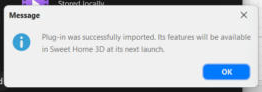
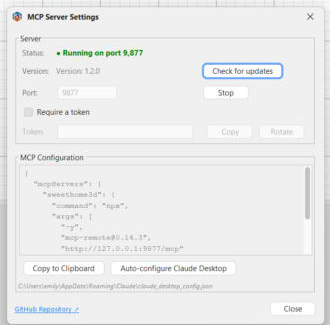

# Sweet Home 3D (Microsoft Store) + MCP: sí funciona 🏠🔌

Notas de cómo conecté el plugin [sweethome3d-mcp-server](https://github.com/grimashevich/sweethome3d-mcp-server) a la versión de Sweet Home 3D que se instala desde la **Microsoft Store** en Windows, qué funcionó, qué no, y los scripts que usé para comprobarlo.

Lo escribo porque el README del plugin solo documenta la versión "normal" (el instalador de SourceForge) y avisa que la versión de la **Mac App Store** no sirve porque está sandboxeada. De la versión de Microsoft Store no decía nada, así que la probé.

Resumen corto: el servidor MCP arranca, responde y dibuja. Lo único que no ve es el catálogo de muebles.

[English version below](#english-version)

## Mi setup 🧰

| Cosa | Versión |
|---|---|
| Windows | 11, laptop ASUS |
| Sweet Home 3D | 7.6.8 Microsoft Store (build 1607), trae OpenJDK 11.0.18 de 64 bits |
| Plugin | sh3d-mcp-plugin-1.2.0.sh3p (GPL-2.0) |
| Cliente MCP | Peticiones HTTP a mano para verificar; Claude Desktop con la config que genera el plugin (pendiente de reiniciar) |

El hash SHA-256 del plugin que instalé, por si quieres comparar con el tuyo:

```
0a47aac9854cf229362701fa06d36b77ea883f386a5201705803231493426a6f  sh3d-mcp-plugin-1.2.0.sh3p
```

## Pasos que seguí ✅

1. Bajé `sh3d-mcp-plugin-1.2.0.sh3p` desde la página de [Releases](https://github.com/grimashevich/sweethome3d-mcp-server/releases) del plugin.
2. Doble clic al archivo. La versión de la Store registra la extensión `.sh3p`, así que Windows lo abre con Sweet Home 3D y sale este mensaje:

   

   No hace falta copiar nada a mano a la carpeta de plugins.
3. Cerré Sweet Home 3D y lo volví a abrir. Al arrancar aparece la pantalla de "Try SH3D Pro for Free". La ignoré; el plugin carga igual.
4. Apareció el menú **Tools → MCP Server...** y el estado dice *Running on port 9,877*:

   

5. Desde ese mismo diálogo le di a **Auto-configure Claude Desktop**. Escribió el servidor `sweethome3d` en `%APPDATA%\Claude\claude_desktop_config.json` y dejó una copia `.bak` del archivo anterior. La configuración que genera usa `npx -y mcp-remote@0.14.3 http://127.0.0.1:9877/mcp`, así que necesitas Node.js instalado. Claude Desktop lee ese archivo al arrancar: hay que reiniciarlo.

### Dónde quedó el plugin

Desde el diálogo de abrir archivo de Sweet Home 3D, la carpeta `%APPDATA%\eTeks\Sweet Home 3D\plugins` muestra el `.sh3p` junto a `sh3d-mcp.log.0`. Las apps de la Store pueden redirigir `AppData` a su carpeta `LocalCache` del paquete (`%LOCALAPPDATA%\Packages\eTeks.SweetHome3D_y7v7etvrysvmm\...`), así que si lo buscas desde el Explorador y no aparece en Roaming, mira ahí. No comprobé cuál de las dos rutas es la física.

## Cómo verifiqué que de verdad responde 🔍

Todo contra `http://127.0.0.1:9877`:

- `GET /health` devuelve `{"status":"ok"}`.
- `POST /mcp` con `initialize` devuelve `protocolVersion: 2025-03-26` y `serverInfo: { name: "sweethome3d", version: "1.2.0" }`, con su `Mcp-Session-Id` en la cabecera.
- `tools/list` devuelve 46 herramientas.
- Con `batch_commands` creé 13 paredes, 8 habitaciones, 14 cotas y una docena de etiquetas de una sola vez, y después `save_home` y `export_plan_image` escribieron el `.sh3d` y el PNG en `Documents` sin problema.

El script [`scripts/smoke-test.mjs`](scripts/smoke-test.mjs) repite esa comprobación:

```powershell
node scripts/smoke-test.mjs
```

Y [`scripts/demo-batch.mjs`](scripts/demo-batch.mjs) dibuja una casita de dos cuartos con una puerta y una ventana, para ver el plugin trabajando en tu pantalla:

```powershell
node scripts/demo-batch.mjs "C:\Users\TU_USUARIO\Documents\demo-mcp.sh3d"
```

Ojo: el demo borra la escena actual (`clear_scene`). Guarda lo tuyo antes.

## Lo que NO funciona en la versión de Store ⚠️

El catálogo de muebles llega vacío al plugin:

```
list_categories  →  {"categories":[],"totalItems":0}
place_furniture  →  Furniture not found by catalogId: 'eTeks#door'
```

El plugin lee el catálogo con `userPreferences.getFurnitureCatalog()` (está en `HomeAccessor.java`). En la versión de Store esa llamada devuelve cero piezas, aunque el panel de muebles de la app sí muestra el catálogo. Así que estas herramientas no sirven aquí:

- `list_categories`, `list_furniture_catalog`
- `place_furniture`
- `place_door_or_window`

No investigué por qué. Si alguien lo averigua, abre un issue aquí o en el repo del plugin.

### Lo que hice en vez de eso

- Puertas: en lugar de una pieza de catálogo, dejé el hueco en la pared (dos tramos de `create_wall` con la separación del vano) y puse la hoja abierta como una caja con `generate_shape` (modo `box`, 91 × 4 × 205 cm). En el plano se ve como puerta y en 3D también.
- Ventanas: una caja de vidrio con `generate_shape` en el espesor de la pared, con `elevation` a la altura del antepecho y `transparency: 0.45`.
- Muebles: cajas con `generate_shape` con las medidas reales de cada mueble y su nombre.

Todo eso sí funciona en la versión de Store. El demo usa exactamente esas tres técnicas.

## Otros detalles de la versión de Store 📝

- Las unidades vienen en pies y pulgadas. Se cambia en **File → Preferences → Unit → Centimeter**. El plugin siempre trabaja en centímetros, da igual lo que tengas en la interfaz.
- La pantalla de "Try SH3D Pro for Free" sale en cada arranque. No afecta al plugin.
- Brave no completó la descarga del `.sh3p` por su cuenta: dejó un `.tmp` en Descargas esperando confirmación. Si no te aparece el archivo, revisa la burbuja de descargas del navegador.
- Si compartes la laptop con alguien, activa **Require a token** en Tools → MCP Server. Por defecto cualquier programa de la máquina puede hablar con el puerto 9877.

## Lo que me queda por probar

- Confirmar que Claude Desktop conecta después del reinicio con la configuración que generó el botón.
- `load_home` con un `.sh3d` que traiga los modelos de puertas y ventanas embebidos, para rodear el problema del catálogo.

## Créditos

El plugin es de [grimashevich](https://github.com/grimashevich/sweethome3d-mcp-server) y colaboradores, licencia GPL-2.0. Sweet Home 3D es de eTeks / Space Mushrooms. Estas notas y los scripts van con licencia MIT.

---

## English version

Notes on connecting the [sweethome3d-mcp-server](https://github.com/grimashevich/sweethome3d-mcp-server) plugin to the **Microsoft Store** build of Sweet Home 3D on Windows. The plugin's own README documents the SourceForge installer and warns that the Mac App Store build is sandboxed and can't open the port. It says nothing about the Microsoft Store build, so I tried it.

Short version: the MCP server starts, answers and draws. The only thing it can't see is the furniture catalog.

### Setup

Windows 11, Sweet Home 3D 7.6.8 Microsoft Store (build 1607, bundled OpenJDK 11.0.18 64-bit), plugin `sh3d-mcp-plugin-1.2.0.sh3p` (SHA-256 `0a47aac9…6a6f`, see above), Claude Desktop as the client plus raw HTTP calls for verification.

### Steps

1. Download the `.sh3p` from the plugin's Releases page.
2. Double-click it. The Store build registers the `.sh3p` extension, Sweet Home 3D opens and shows "Plug-in was successfully imported. Its features will be available in Sweet Home 3D at its next launch." No manual copying needed.
3. Restart Sweet Home 3D. A "Try SH3D Pro for Free" screen appears first; the plugin loads anyway.
4. **Tools → MCP Server...** shows *Running on port 9,877*, version 1.2.0.
5. **Auto-configure Claude Desktop** writes the `sweethome3d` entry (`npx -y mcp-remote@0.14.3 http://127.0.0.1:9877/mcp`) into `%APPDATA%\Claude\claude_desktop_config.json` and keeps a `.bak`. You need Node.js, and Claude Desktop has to be restarted to pick it up.

From inside the app's file dialog the plugin lives in `%APPDATA%\eTeks\Sweet Home 3D\plugins`. Store apps may redirect that to the package's `LocalCache` folder, so check there if Explorer doesn't show it in Roaming. I didn't verify which path is the physical one.

### Verified

`GET /health` → `{"status":"ok"}`. `initialize` → protocol `2025-03-26`, server `sweethome3d 1.2.0`. `tools/list` → 46 tools. A single `batch_commands` call created 13 walls, 8 rooms, 14 dimension lines and a dozen labels; `save_home` and `export_plan_image` wrote to `Documents`. `scripts/smoke-test.mjs` repeats the check; `scripts/demo-batch.mjs` draws a two-room demo (it clears the current scene first).

### What doesn't work on the Store build

The furniture catalog arrives empty: `list_categories` returns `{"categories":[],"totalItems":0}` and `place_furniture` / `place_door_or_window` fail with `Furniture not found by catalogId`. The plugin reads it through `userPreferences.getFurnitureCatalog()` (`HomeAccessor.java`), which returns zero pieces here even though the app's furniture panel shows the catalog. I didn't dig into why.

Workarounds that do work: wall gaps plus a `generate_shape` box for the door leaf, a translucent `generate_shape` box at sill height for windows, and `generate_shape` boxes with real dimensions for furniture.

### Other Store-build notes

Units default to feet/inches (File → Preferences → Unit → Centimeter); the plugin always speaks centimeters. The Pro trial screen shows on every launch. Brave left the `.sh3p` download as a pending `.tmp` in Downloads until confirmed in its download bubble. Turn on **Require a token** if you share the machine.

### Still to test

Claude Desktop connecting after a restart with the generated config, and `load_home` with a `.sh3d` that embeds door and window models.
